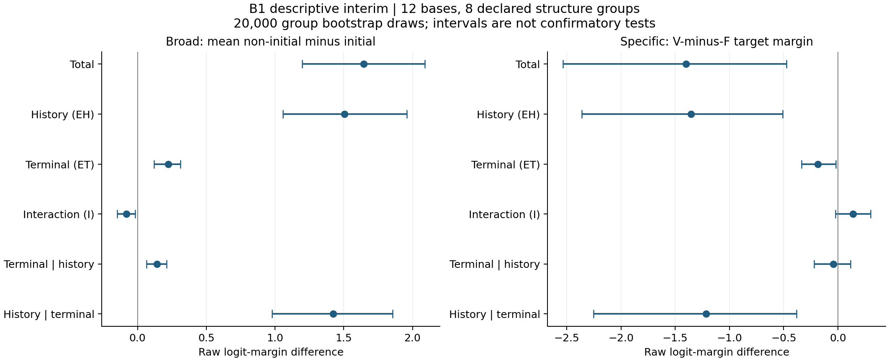
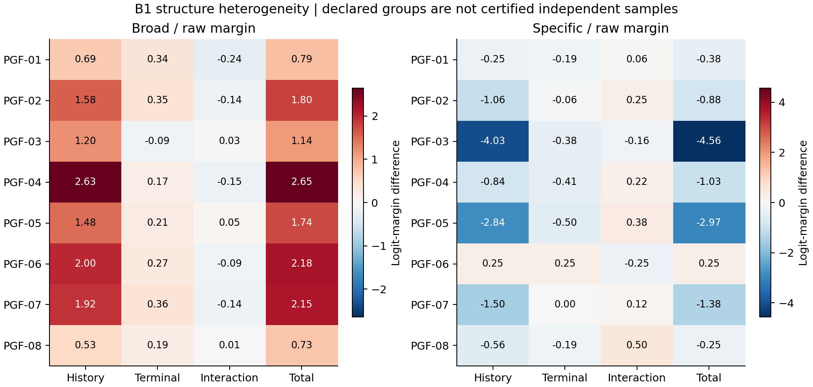

# CEDAR B / Round 1（B1 首包） / initial-package-closure / 2026-10-06

## 1. 执行结论

CPU A/H 准备、smoke 24/24、B1 192/192 及自动分析完成。全部 216 条 JSON 与 216 个数组逐项核验，计划格集合和 results.json 一致；冻结依赖、操作修订和 26 个模型/cap 资产全量哈希通过。无剩余本批 campaign、runner 或分析进程，两个锁已释放。监控在归档同步完成后暂停，最终暂停状态见 closure_status.json。

## 2. 实验身份与要解决的问题

B1 是已授权的历史×末步四格干预首包，用来分辨原 cap 效果的计算时间位置。Round 1 对应 B1 首包，不是新一次独立确认。旧 C1/S1/P1 和旧失败 v2 均未重启。

## 3. 设置与协议

12 bases × NRVF × 00/10/01/11 = 192 个完整重放。保持 BF16、原权重、cap 算法、轨迹、terminal 边界与数值门槛。24 次 smoke 包含重放重复，只验证工程一致性。00/11 锚点、重复和重建的最大误差均为 0；保留原冻结协议，资源修订仅取消累计 12h 和 smoke 3h 时限。

## 4. 主要发现

历史项 EH：broad +1.504，specific −1.355；末步项 ET：broad +0.225，specific −0.184；总变化：broad +1.646，specific −1.398。平均而言历史阶段项更大，但末步并非被证明为零。已有历史干预时再加末步：broad +0.142，specific −0.043。各结构不完全同向。

“让其他选项相对原答案分数上升”与“V 相比 F 更偏向目标答案”不能互换。前者上升而后者下降，因此本批不能被包装成理由利用普遍改善。仿射校正后 broad 总变化约 +0.606（历史 +0.562），specific 总变化约 −0.480，描述性区间 [−1.165, +0.138] 跨零。效应幅度对输出尺度校正敏感；原始与校正结果必须同时报告，不选择有利尺度，也不由跨零断言无效应。

## 5. 统计核验

全部原始 margin、配对端点、两种聚合和描述性 bootstrap 区间完成独立 CPU 核验；未运行中期主 p 值。等权对象是 8 个声明结构组，独立性尚未认证；12 family 是敏感性加权。B2 后的六项 Holm 家族只执行一次。无等效界限、无多模型 seed 复现、无自然生成行为证据。

## 6. 图表逐项解释

图 1 展示历史项大于末步项的数值模式及两个指标的不同方向，使后续定位优先考虑历史路径；不支持把历史项除总变化当作因果解释比例。图 2 显示各旧结构的异质性，要求继续保留所有结构和冻结 B2。

## 7. 失败、负结果与限制

初始部署遗漏空 h1 目录的失败记录已保留，工程修复后完成；原科学代码未因此更改。早期 SSH 曾短暂超时，重连恢复，没有重启推理。完成时原监控选中了更新的空分析日志，产生跨文件负增长；实际推理日志继续增长，closure_integrity.json 已说明并重算同一日志差值。

特异性原始指标下降是需保留的结果，不据此取消 B2，也不据有利 broad 选择继续。B1 只覆盖旧开发结构，H 新独立结构认证数为 0。既不能确认完整论文机制，也不能由此证明机制不存在。

## 8. 对假说的影响

“需要检查历史计算路径”得到描述性支持；“末步局部读出足以解释主要现象”更难与当前数值相符。“cap 会改善理由选择性/自然推理行为”本批没有提供支持。具体层、KV、助手方向的因果定位仍未解决。

## 9. 下一步

建议按原冻结矩阵执行剩余 B2 192 格（需要下一包明确授权，本批未启动），不根据 B1 效应符号改样本。随后同时报告 B1/B2/合并，执行预定六项检验。C 必须在 B 完整后确定一个定位范围，完整 KV 交换先作实现校验；D 暂缓。

H 可先完成原型→真实依赖组→family→base 注册和结构认证。48 组只是规划目标，不能同构改名凑数；需先定义有科学意义的精度/效应目标。另冻结自然行为分母、无效与截断处理及固定重放可用率。现有 H 精度文件是情景规划，不是功效保证；H 模型矩阵未获本包启动授权。

## 10. 资源与可复查产物

累计 GPU 加载/推理墙钟 20831.457 秒（5.787 小时）；smoke 2179.022 秒，B1 18652.435 秒。这是 4 卡并行任务的经过时间，不是各卡 GPU 小时之和。无累计时限；保留 90 分钟无推进与磁盘/显存门槛。

原始证据完整包 B1_complete_evidence_20261006.tar.gz，内部 evidence_manifest.json 逐文件列出哈希；报告及图另存 reporting_bundle_20261006.tar.gz。见 closure_integrity.json、analysis_verification.json、scale_refit_verification.json、transfer_receipt.json 和 closure_status.json。全部本地产物保存 D:/CEDAR；未向 Obsidian 或论文源文件写回。

当前决策：结束本包监管并保留全部证据；B2/H 为下一步候选，等待下一包授权，不自动扩展。
