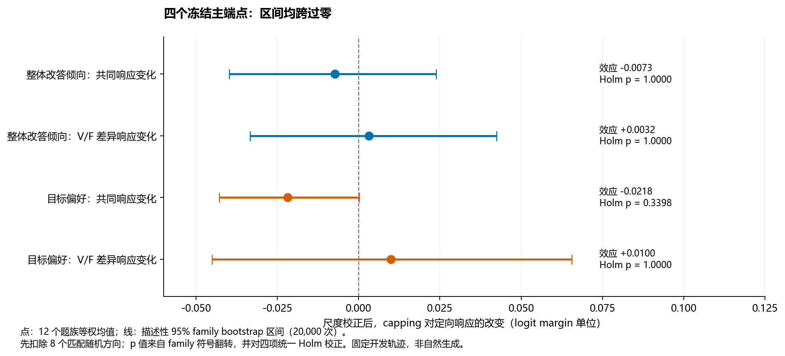
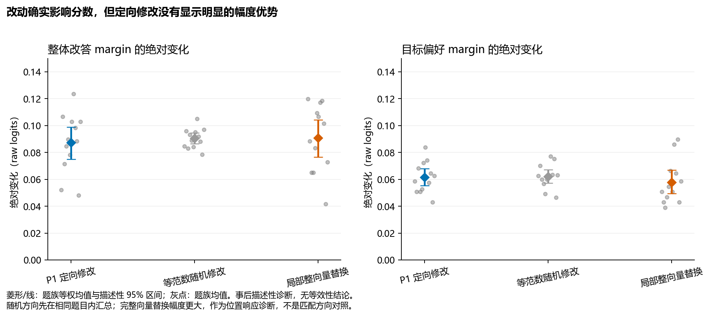
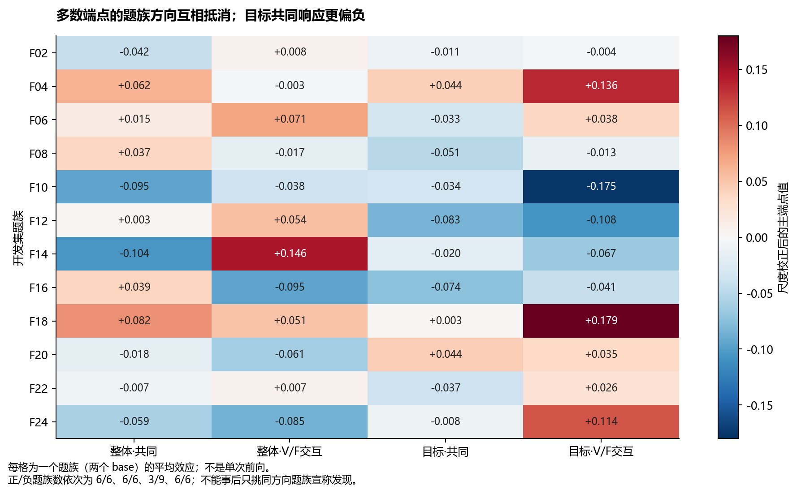
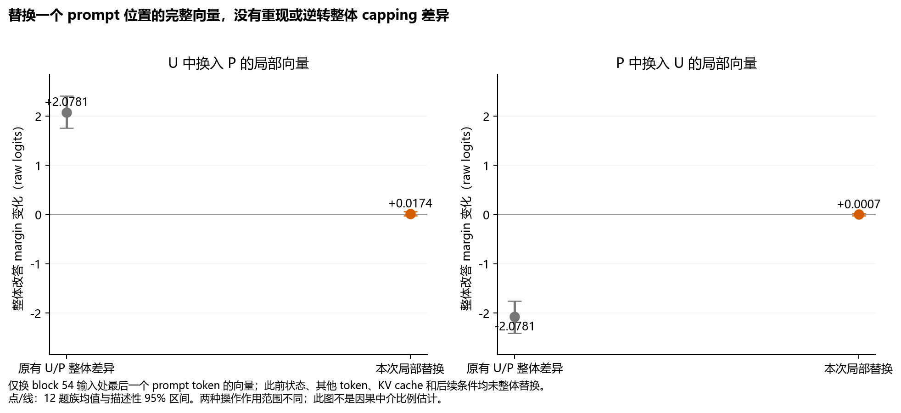

# CEDAR C1 signed-dose / Round 1 / Hypothesis Review / 2026-10-03

这里的 Round 1 指当前 signed-dose C1 协议的首个完成批次，不混入旧 C1 工程失败或前批 S1/P1。结果解释面向项目决策，不是论文正文。全部新文件保存在 D:/CEDAR；未尝试 Obsidian 写回，未改在线或本地论文。

## 1. 结论

C1 执行成功，但四个冻结机制主端点未获得阳性支持。已有的“capping 改变答案分数几何”现象和“V/F 标签跨条件可解码”证据仍成立于其原范围；没有因此证明所测可解码方向被模型用来作理由敏感决策，也没有证明 capping 改变其使用增益。

最合适的论文位置仍是理由敏感的评估与受控诊断。可以报告本次机制负结果；不能把机制未获支持变写成表征—策略解耦已得到因果证明。

## 2. 为什么做这次实验

前批 S1 问一般尺度是否解释分数变化；P1 问 hidden state 能否读出 V/F；C1 进一步操纵事前确定的方向，问它是不是一个可控制最终答案响应的因果变量，及 capping 是否改变这个控制关系。

直观上，P1 像找到一个能显示设备状态的读数；C1 检查沿这个读数对应的内部方向修改，是否真的能控制设备的输出。能读取与能控制是两件事。不能由 C1 阴性断言设备从不使用这个信息，因为也可能选错控制位置、时刻或操作范围。

## 3. 设置和统计单位

Qwen3-32B、BF16、原 p25、固定已有 uncapped-source 轨迹。只在最后一个 prompt token 的 L53 后状态修改一次，即 zero-based block54 输入，其他 token 与后续 decode 状态不直接修改。24 bases、96 prompts、12 families；52 smoke 和 3840 正式前向。

3840 = 192 noop + 192 局部完整向量替换 + 384 真方向正负修改 + 3072 随机正负修改。八个随机方向、两个符号、多个条件是同批对象的配对对照，不增加独立样本数。运行约五天并不意味着有几千个独立问题支持小效应推断。

主端点先扣匹配随机响应、再比较 P/U 的共同与 V/F 差异响应，分别看 broad/specific。四项一起校正，多重比较规则冻结。12 family 均值是分析单位，训练折重叠与开发复用限制推断。

## 4. 主要结果

| 指标 | 效应 | 描述性 95% 区间 | Holm p |
|---|---:|---|---:|
| broad 共同响应变化 | −0.00733 | [−0.03975, +0.02382] | 1.00000 |
| broad V/F 交互变化 | +0.00319 | [−0.03343, +0.04240] | 1.00000 |
| specific 共同响应变化 | −0.02183 | [−0.04286, +0.00020] | 0.33984 |
| specific V/F 交互变化 | +0.00997 | [−0.04513, +0.06553] | 1.00000 |

这些数是 logit margin 响应变化，不是准确率或百分点。最后两列特别容易被误解：区间跨零不是效应必为零，p 值也不是“假说为真概率”。它们表示这组设计未分辨出可靠的主效应。

三个端点题族正负各半；specific 共同响应 9 个负、3 个正，逐个删除 family 仍为负，可以留下作弱线索，但多重校正和独立确认未过，不能称为已找到 capping 对理由通路的抑制。

工程上不存在“根本没改进去”：所有 384 个真方向修改符号正确，实际投影剂量约达到计划的 99.36%。随机范数匹配最大误差 0.0631%，小于 0.5% 门槛；noop 完全一致。

## 5. 统计与对照验证

真方向使至少一个选项分数改变 294/384 次，随机方向 2403/3072 次；raw broad 绝对变化均值为 0.0873 vs 0.0905，specific 为 0.0616 vs 0.0622。大小近似不是严格等效性证明，但提醒我们不能将“推动后分数变了”就当作所学方向特殊。

同时检查正负有限差分与正负平均，避免把双向效应在平均中消掉后误称无变化；按 family 汇总的配对绝对响应诊断也没有明显方向优势。完整计算、区间、效应量见 stats-appendix.md、diagnostics.json。

3840 条都没有第一名翻转。原始第一名领先第二名最小 5.375、中位 14.9375，所有扰动的保守最大竞争差改变上界都低于原始领先差距。因此它是分数改变未越界的结果，不证明模型内部完全无变化，也不证明自然生成完全不受影响。

## 6. 图表逐张解读

图 1 回答主问题：所有主端点区间跨零，无法据此建立定向增益或 V/F 特异响应机制。specific 共同响应更偏负，但不能从四个主项中挑它并更换显著性规则。

图 2 区分一般扰动与方向特殊性。真方向、随机方向以及更大剂量的局部完整向量替换都会产生小分数变化。只记录有无变化会误判；匹配随机对照提供了这批计算最重要的判断依据之一。完整替换剂量不同，不能作为等范数方向检验。

图 3 显示均值由什么组成。多数端点并非每个题族都呈很小同向效应，而是正负交错。不能事后删去“反向”题族或只写最好例子；可将表现差异关联到事前定义的结构元数据，但只能探索并留待新结构验证。

图 4 的原有 full P−U broad 差异仍为 +2.0781，但 P 向量换入 U 的平均变化仅 +0.0174，U 向量换入 P 仅 +0.0007。该单位置替换未形成强双向恢复。只能说这次局部操作不足，不能据此宣称所有层所有时刻都无因果作用，不能计算所谓中介解释率。

## 7. 负结果与关键限制

本次没有已验证的强位置阳性对照。局部完整向量替换平均位移为原状态的 18.57%，是真方向位移约 27 倍，但仍无稳定 broad 恢复。这削弱“该位置藏着主要开关”的简单解释，同时使定向阴性无法专门归罪于语义方向。

替换不是整个模型状态移植：其他 prompt tokens、既有 KV cache、其他层与后续 capping 过程仍在。固定后续文字还排除了经由新生成文字影响最终答案的部分路径。分布式或时间累积解释与结果相容，但并没有因此被证明。

BF16 非零选项差有 0.0625 等离散步长；小效应分辨有限。不能事后改精度或增剂量把原实验“修到显著”，那会成为新实验。

488 个二级指标中有 36 个原始 p<0.05；相关且重复，不是 36 个发现。探索性整体 Holm 后无项通过。较窄 16 项 arm/condition 指标的两项 nominal p 也未过校正。主检验判定保持不变。

## 8. 假说和论文现在受到什么影响

| 主张 | 当前判断 | 原因 |
|---|---|---|
| 激活控制应接受理由敏感的审计 | 保留 | 分数、答案、理由标签和操作效应不是同一维度 |
| full capping 改变固定轨迹答案几何 | 保留在既有范围 | 原有条件差异在 noop 中复现；不是本次定向因果效应 |
| 一般尺度足以解释全部现象 | 不能这样写 | S1 非选项拟合改善明显，但主源 V/F 校正残差仍存在 |
| capping 后 V/F 标签完全消失 | 不符合现有 P1 | 跨条件可解码性尚在，但不是完整语义保持证明 |
| 所测 P1 方向是一个可直接控制理由决策的开关 | 没有得到支持，简单版本受削弱 | 主检验、随机参照及局部替换均未给出预期强证据 |
| 表征保留而下游使用被改变 | 仍待判别 | P1支持有限读取，C1没有识别出具体被改写的因果使用关系 |
| 单轴控制按耦合程度重新分配各通路增益 | 仍为猜想 | 未直接测耦合—增益函数，也未获本次具体响应差异支持 |
| 已证明一般认识论损害、能力没有损失或新控制器有效 | 不支持 | 范围和识别证据不足；H1/缓解实验未完成 |

本地论文中的“只由 exposure 而非 assessment 决定”“任何连续 V/F 对比都没有差异”等绝对句必须按最新 S1 和 C1 范围重写，不能继续一概而论。跨实验的端点、轨迹来源、校正方式并不相同，应分别陈述。C1 也不能把解耦从有吸引力的解释升级为已证实机制。

评价型论文的主线可以保留，机制型论文的强承诺尚未完成。录用价值取决于完整贡献、独立性、比较和写作，不能由一项 p 值或运行时长保证。

## 9. 后续决定

停止把这个单点 P1 方向当作已验证的控制器；不按结果补选 layer、剂量或题族，不重跑同矩阵追显著。

继续利用并发布完整证据链：现象→尺度控制→迁移解码→匹配因果干预负结果→范围限制。新增的四图、全题族表、原始/校正敏感性、正负响应拆分和随机参照都应保留，而不是只在论文角落写一句“不显著”。

若目标是加强论文可信度，优先 H1 真正独立结构及精度冻结，先复制最稳的现象与尺度残差。若必须证明机制，应先制定一个小型、事前限定、能证明所选时空操作确实控制目标读出的协议，再谈方向特异性。不得把扩大搜索等同于提高证据质量。

本轮已完成原记录 CPU 分析；没有启动新的 GPU、H1 或 Jev 实验。

## 10. 证据索引

- analysis-report.md：完整分析与 claim candidates。
- stats-appendix.md：主检验、单位、效应量、区间和事后边界。
- figure-catalog.md：每图目的、解释和限制；figures/ 含 PNG/PDF。
- diagnostics.json、readout_resolution.json：全部补充诊断。
- primary_endpoints.csv、family_endpoints.csv：精确数值表。
- provenance.json、analyze_deep.py、plot_diagnostics.py：来源哈希与可重现处理。
- ../closure_20261003/FINAL_VERIFICATION.json：原实验完成核验。
- 原始 NPZ 仍在服务器；本地结果已通过下载清单 SHA256。没有把本轮 CPU 分析伪称新模型实验。

