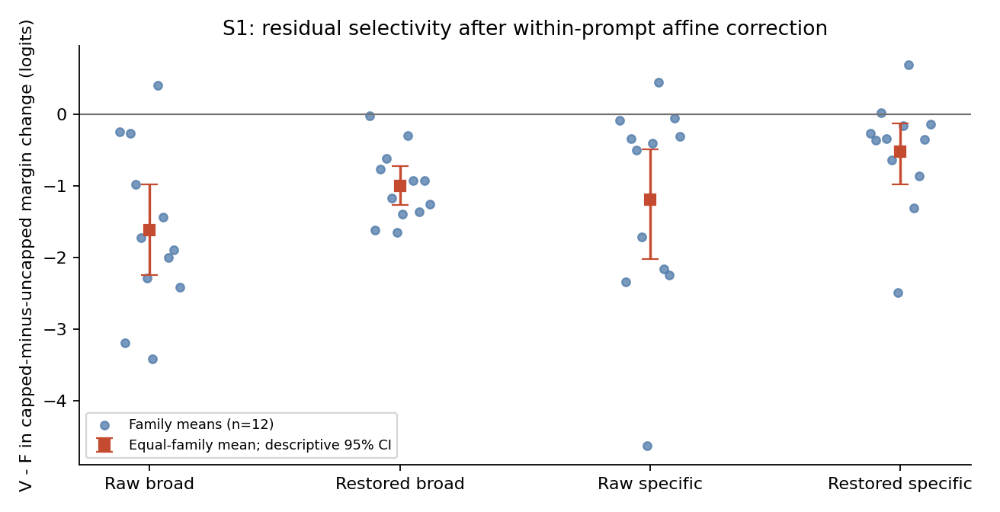
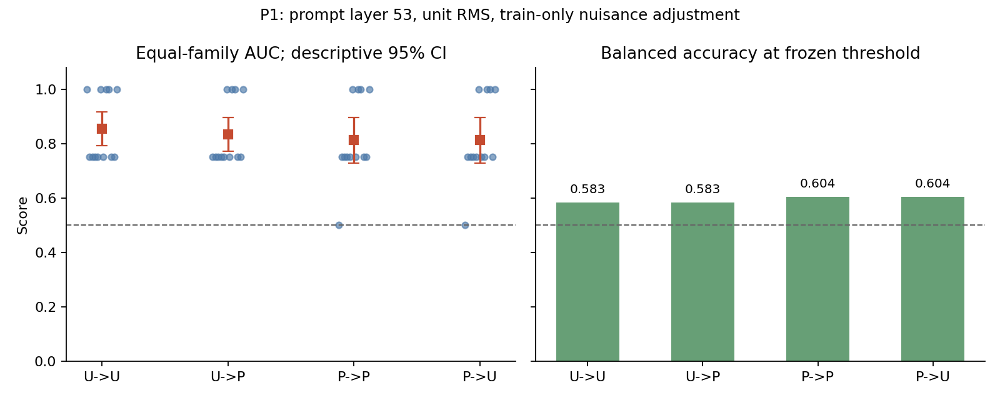

# CEDAR ARR / Round 1 / Round Review / 2026-09-28

## 1. 摘要与决定

第一批冻结程序于北京时间 **2026-09-28 05:38:19** 完成：原版权重恢复与校验、12 次 smoke、384 次正式固定轨迹前向、S1 和 P1 均结束。05:51 的监控快照确认没有仍需监管的本批计算进程；随后完成数据与统计核验。本批结束不等于全部 ARR 补实验完成。

尺度/仿射预测明显降低选项 logits 的预测误差，但主源的尺度校正后 V−F margin 差异仍存在。P1 主探针的四方向 family AUC 为 0.8125–0.8542，支持有限范围的跨条件标签可解码性。它们支持继续设计 C1，尚不能证明因果机制或跨新结构泛化。C1/H1 未排跑。

## 2. 实验身份与决策问题

问题是：capping 的影响在多大程度上体现为一般读出尺度变化；去除该尺度后是否仍有 V/F 相关差异；同一个训练后的探针能否转移到另一 capping 条件。协议在新模型结果出现前冻结，但整个项目仍是开发分析，不能回溯称为原论文预注册确认。

远程根目录为 `/data4/WuMingrui/TianJinyu/CEDAR`。本报告仅覆盖当前第一批 S1/P1，不覆盖新的自然生成、C1 因果干预或 H1 独立结构确认。

## 3. 设置与评估协议

- Qwen3-32B 原版 BF16、SDPA；固定 revision `9216db5781bf21249d130ec9da846c4624c16137`；原 p25 cap；Torch 2.6.0+cu124、Transformers 4.56.1。
- 192 条原始轨迹，每条运行 U/P，合计 384 次。uncapped-source 96 条为主源，capped-source 96 条为敏感性源。24 个 base、12 个结构 family；family 是不确定性统计单位。
- S1 对选项 token 和其识别到的单 token 空白变体排除拟合；非选项 fit/test 不重叠。same-prompt 与 family-out 参数拟合分开报告。
- P1 主分析为主源 V/F 48 条、24 个配对 base、12 个留出 family；prompt 边界第 53 层、unit-RMS，initial/target nuisance 回归和标准化仅拟合训练 family；Logistic C=1。
- 一次固定采集配置，无独立模型种子复现。100 次成对标签置换完整重训外层折。没有改变精度、轨迹、样本、指标或冻结协议。

## 4. 主要发现

主源的 family 等权选项预测 RMSE：identity **3.4204**，same-prompt scale **1.3209**，same-prompt affine **0.9328**；family-out scale **1.3528**，family-out affine **1.2315**。这是预测误差的描述性改善，不能换算成已验证的因果解释率。

S1 先计算每条轨迹 P−U 的 margin 变化，再在 base 内计算 V−F。broad 是其他三选项均值减初始答案；specific 是目标答案减两个非初始/非目标选项均值。restored 使用正斜率 affine 校正。

| 主源 V−F 对比 | 均值（logits） | 描述性 95% CI | Holm p |
|---|---:|---|---:|
| raw broad | -1.6233 | [-2.2431, -0.9844] | 0.005859 |
| restored broad | -1.0043 | [-1.2657, -0.7217] | 0.001953 |
| raw specific | -1.1979 | [-2.0260, -0.4896] | 0.011719 |
| restored specific | -0.5209 | [-0.9802, -0.1362] | 0.024414 |

restored broad 为 12/12 family 负向，specific 为 10/12 负向。残差未降到本次全状态重复误差底噪（0）；这只排除了“本次拟合校正完全抹除差异”的表述。

| P1 训练→测试 | family AUC | 描述性 95% CI | balanced accuracy | Holm p |
|---|---:|---|---:|---:|
| U→U | 0.8542 | [0.7917, 0.9167] | 0.5833 | 0.039604 |
| U→P | 0.8333 | [0.7708, 0.8958] | 0.5833 | 0.039604 |
| P→P | 0.8125 | [0.7292, 0.8958] | 0.6042 | 0.039604 |
| P→U | 0.8125 | [0.7292, 0.8958] | 0.6042 | 0.039604 |

AUC 较高但 balanced accuracy 有限，不能宣称稳定的有效性分类器，更不能据此称为语义有效性通路。

## 5. 统计与完整性核验

396 个前向 NPZ 与采集时保存的 SHA-256 全部匹配，396 条汇总记录与逐条 JSON 一致，输入轨迹哈希及 6 项来源指纹全部一致。196 对 smoke/formal 归一化 counterfactual 产物身份、方向、形状和有限值检查通过。正式 384 条记录的历史 A/B/C/D logits 最大偏差为 0，末层重建误差为 0；smoke 全状态重复误差为 0。历史精确一致仅指有历史参照的选项 logits，不扩展到未保存的历史全状态。

S1 四个主对比以 12 个 family 为单位，20,000 次描述性 bootstrap，枚举 4096 种 family 符号翻转并作四项 Holm 校正。独立、对称 family 效应是检验假设，不能从少量样本中视为已证明。

P1 全部 24×4 个配置/方向的保存分数、AUC、balanced accuracy、描述性 CI 均重算一致；四个主方向各有 100 个置换结果，原始 p=1/101，四项 Holm 后 p=4/101。未再次训练 100 次探针，核验对象是完整保存分数与零分布；置换可交换性和重叠外层训练集限制仍存在。

1266 项来源与产物哈希及具体检查见 `batch_integrity_20260928.json`。65GB 模型 shard 沿用采集前逐 shard 校验，不重复全盘读取。counterfactual 数组没有采集时独立期望哈希，本次建立的是事后哈希，不能称为采集前校验。

## 6. 图表解读

图 1 展示主源 raw/restored 的 family 差异。点为 family，方块为等权均值，误差线是描述性 95% bootstrap CI。校正后差异缩小但仍存在，specific 有异号 family；该结果支持匹配干预的下一步设计，不能直接确定因果解释。

图 2 同时展示四方向 AUC 和 balanced accuracy。排序性能与阈值分类性能差异明显；保留完整指标能避免只选高 AUC 的结论。原始 S1 `heldout_prediction.pdf` 还展示单条轨迹的 identity/affine 误差，属于 within-prompt 图，不是 unseen-family 泛化图。

## 7. 负结果、失败记录和限制

- 两个来源各 96 条的 A/B/C/D argmax flip 均为 0/96；不能称为新增的自然生成行为变化。
- capped-source 的 restored specific 均值 **0.0902**，描述性 CI **[-0.2836, 0.4416]**，跨 0；主源结果不能泛化为所有轨迹源一致。
- 12 个 family、P1 每 family 4 条，AUC 粗粒度；outer-fold 训练集重叠，P1 bootstrap CI 仅为描述性。单模型、单运行配置，不代表跨模型普遍性。
- 本批冻结程序已执行完成，但更广协议的附加诊断尚不齐：P1 未输出 capped-source 探针敏感性或单独预测 initial/target 身份的 nuisance endpoint；S1 未单独导出 family-out 非选项测试误差。它们不能被标为已完成；补充时须使用独立产物并记录分析时点。
- 已保留早期网络下载失败、瞬时重试、监控文件重命名竞态及 SSH 重连记录。没有靠放宽哈希或数值门槛恢复，也没有终止其他用户作业。

## 8. 对当前假设的影响

“一般尺度变化完全解释主源 V−F 差异”未获本批结果支持；“capping 后完全失去 V/F 可解码信息”也不符合主探针结果。仍未解决的是：这些可解码信息是否参与模型决策，以及剩余差异是否属于原因有效性的特定因果路径。主张暂时限于固定轨迹下的尺度残差与跨条件可解码性。

## 9. 产物与复现索引

- `batch_integrity_20260928.json`：逐项核验、1266 项来源/产物哈希。
- `batch_review_20260928/analysis-report.md`、`stats-appendix.md`、`figure-catalog.md`、`provenance.json`：独立核验分析包和允许/禁止的 claim 表述。
- `batch_review_evidence_20260928.zip`：56 个关键结果/日志/源码文件的本地镜像，SHA-256 `df2f09bb9ac7242e974d5124837a0f431db7c8ba0d233987374a70ce5c235280`。
- `batch_evidence_20260928/`：该镜像的展开目录。全部原始 NPZ、token_splits 和方向 NPY 仍保留远程，并已纳入核验；本地镜像不是全量原始数据副本。
- `../scripts/verify_batch_completion.py`、`../scripts/build_batch_review.py`：新增事后核验/汇总脚本；原始分析脚本和输出未改写。
- 按用户指定写入本地与远程 explore_outputs；未尝试 Obsidian 写回。

## 10. 下一步操作

1. 暂停本批 30 分钟监控：计算进程已经退出，无待监管的本批作业。
2. 补齐上述附加诊断的分析计划和产物标注，保留当前主分析；不要改写为事前完成。
3. **C1**：冻结 prompt L53 的干预对象、原始或 unit-RMS 方向的映射方式及剂量。已导出的 24 个 candidate 方向来自 raw 表示，不能不加说明当作 unit-RMS 主探针方向。沿训练 family 方向做 U→P、P→U 同条目分量移植；包括 no-op、等维/等实际范数随机方向、完整状态替换阳性对照。读出同时报告 raw 与 S1 校正后的 V−F selectivity，不在测试 family 上挑层或剂量。当前未启动 C1。
4. **H1**：先冻结 S1/P1/C1 预测和最小有意义效应，以 pilot family 方差制定独立结构数与 precision/power 曲线；独立 solver 验证新 V/F 结构。换实体名或 random salt 不算新结构；当前未启动 H1。
5. 稿件表述只推进到“开发集上的尺度残差与跨条件可解码性”；原因使用、因果机制和独立泛化继续保持待验证。
