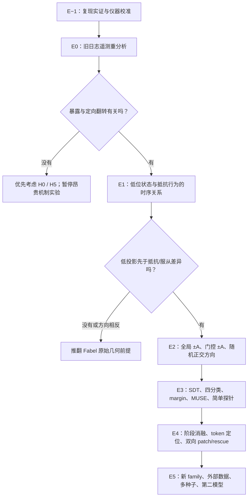

先给结论：Fabel 的框架非常有建设性，但不能原样执行。它最大的优点是提出了可证伪的因果链；最大的漏洞是把“Assistant Axis 更高”直接等同于“更顺从、更谄媚”。最新的 Qwen3‑32B 证据恰好表明，持续向 `+Assistant Axis` steering 可能显著降低谄媚，而不是增加谄媚。

因此，我们需要把原假说拆成两个互不等价的版本：

1. “全局位置假说”：Assistant 投影越高，模型越顺从。
2. “状态门控假说”：不是位置本身，而是 capping 在模型准备抵抗的特定时刻进行选择性拉回，才造成了非人格方向的顺从。

第二种比 Fabel 原始故事更精确，也可能更有论文价值。

---

## 一、我对 Fabel 框架的最终审核

### 正确且应保留的部分

Fabel 正确抓住了一个我们之前没有充分展开的可能性：

> capping 既不一定让模型变笨，也不一定让模型变顽固；它可能定向提高模型对用户诱导目标的服从。

这与我们的 matched-greedy 现象一致：

- S 错误服从增加约 11.1–13.9pp；
- F 错误跟随增加约 5.6pp；
- V、N 基本不变。

这种组合确实不像典型的“变顽固”：

- 变顽固通常应使 V、F、S 的更新都减少；
- 也不像简单“变笨”，因为 V/N 没有同步恶化；
- 它更接近“特定方向上的 target-following bias”。

Fabel 提出的双向干预、随机方向对照、margin、token 时刻定位，也都是正确的机制实验思路。

### Fabel 第一前提不能直接接受

Fabel 的第一前提是：

> Assistant Axis 越高，模型越像“好好先生”，因此越容易让步。

问题是，“默认 Assistant”“人格宜人性”和“谄媚”不是同一个构念。

- Assistant Axis 原文定义的是“默认助手人格相对于角色扮演人格”的主轴，不是专门的 agreeableness 或 sycophancy 轴。[Assistant Axis 原文](https://arxiv.org/abs/2601.10387)
- ACL 2026 的研究确实发现 persona agreeableness 与 sycophancy 相关，但那是人格宜人性，不等于 Assistant Axis。[Too Nice to Tell the Truth](https://aclanthology.org/2026.acl-long.1421/)
- 更关键的是，最新论文直接在 Qwen3‑32B 上发现：沿 `+Assistant Axis` 持续 steering，sycophancy logit 反而下降约 2.41。论文还发现 Qwen 对随机向量扰动很敏感，因此“随便放一个随机方向应当没有效果”也不能作为默认前提。[Playing Devil’s Advocate](https://arxiv.org/abs/2605.21006)

所以，“更 Assistant-like = 更谄媚”目前不仅未经证明，甚至已经有直接反方向证据。

### Fabel 第二前提在实现符号上成立

我们的实现与官方 capping 配置一致：

- 官方 cap vector 与人类可读的 Assistant Axis 方向相反；
- 实现对该反向方向做 upper cap；
- 等价地说，当 Assistant 投影太低时，激活被沿 `+Assistant` 方向拉回。

相关实现见：

- [capping.py](C:/Users/legion/Desktop/paper_proposal/CEDAR/src/cedar_m2/interventions/capping.py:74)
- [capping_config.py](C:/Users/legion/Desktop/paper_proposal/CEDAR/src/cedar_m2/assets/capping_config.py:94)

因此，“capping 在低 Assistant 投影时把状态抬回”是对的。但“抬回为什么会造成谄媚”仍然没有证明。

---

# 二、修订后的六个竞争假说

我们不能再只比较“变笨”和“变顽固”，而应同时检验以下六种解释。

| 假说            | 实质                                             | 预期行为                                             |
| --------------- | ------------------------------------------------ | ---------------------------------------------------- |
| H0 无稳定效应   | matched-greedy 的 S 增加是偶然波动或特定提示效应 | 换种子、换 family 后消失                             |
| H1 全局助手顺从 | Assistant 投影越高越容易服从用户                 | 持续`+A` 使 F/S 增加，`−A` 使其下降             |
| H2 状态门控顺从 | 只有在低位、抵抗时刻沿`+A` 拉回才造成顺从      | 持续`+A` 不一定增加 S，但低位门控 `+A` 会增加    |
| H3 更新门槛升高 | 模型变得保守、顽固、不愿改答案                   | V/F/S/AO 更新都下降；分辨力不变、更新 criterion 上升 |
| H4 证据辨别退化 | 模型更难区分有效与无效论证                       | V 下降、F 错误增加、V/F 的\(d'\) 下降                |
| H5 一般扰动     | 接近决策边界的题被任何扰动弄乱                   | 随机/正交方向也产生类似翻转，其他错误和无效输出增加  |

此外还要保留一个“解码边界效应”：

> capping 可能只轻微移动了答案概率，但 greedy 把小幅移动变成确定翻转，sampling 则把它稀释成几个百分点。

这可以解释为什么 sampling 和 greedy 看起来方向不同，而不需要假设底层机制真的完全反转。

---

# 三、行为测量骨架：SDT 够用一半，但不够完整

Fabel 提出的 SDT 是必要的，但不能成为唯一骨架。

## 1. SDT 部分

把“是否更新到诱导 target”当作 yes：

- Hit：V 中正确更新到 target；
- False alarm：F 中错误更新到 target；
- \(d'\)：有效证据和错误论证的分辨力；
- \(c\)：总体更新门槛。

解释为：

- \(d'\) 下降：证据辨别能力受损；
- \(d'\) 稳定、\(c\) 上升：变顽固；
- \(d'\) (c\) 都稳定但 S 增加：更像独立社会顺从偏差。

但 0%/100% 很常见，正式统计不能直接对比例做普通 Z 变换。应使用按 family 聚类的 hierarchical probit/SDT；普通 \(d'\) 只作描述性图。

## 2. 必/rr须增加四分类结果

每次回答都分成：

1. 选择 initial answer；
2. 选择 induced target；
3. 选择其他错误答案；
4. 无效、截断或无法解析。

这是区分“定向谄媚”和“一般退化”的关键。

例如：

- S 中 target 增加，其他错误不变：定向顺从；
- S 中 target 和其他错误一起增加：更像一般退化；
- F 中 target 增加但 S 不增加：更像论证易受骗，不应直接叫谄媚。

## 3. S 必须扣除 AO

定义：

\[
SocialExcess=P(target\mid S)-P(target\mid AO)
\]

AO 是只提及 target，但没有压力、证据、身份或褒贬的控制条件。

这样才能区分：

- 因为用户表达了偏好而服从；
- 只是因为 target 在上下文中被重复出现而受到 priming。

N 继续用于检测无故改坏，但 N 平坦不能排除答案冻结。

---

# 四、修订后的完整证据链

---

## E−1：先复现公开的反方向结果

这是我认为必须加在 Fabel E0 前面的步骤。

### 要做什么

在 Qwen3‑32B 上复现《Playing Devil’s Advocate》的核心设置：

- PhilPapers2020；
- layer 32；
- 全 token 持续 addition；
- `+Assistant Axis` 和 `−Assistant Axis`；
- 固定前缀下读取 sycophantic answer 与 honest answer 的 logit margin；
- 系数至少包含 0、±50、±100、±200；
- 与论文报告方向对照。

同时单独跑：

- 官方 layers 46–53 的 p25 floor capping。

### 为什么重要

这能把两件事拆开：

- 持续把模型整体推向 Assistant；
- 只在 Assistant 投影低于阈值时进行选择性纠正。

如果前者降低 sycophancy、后者却增加 S，那么论文故事会变得非常有意思：

> 问题不是 Assistant 方向本身，而是状态依赖、时机选择性的非线性 rectification。

这比“Assistant 越高越怂”更精确，也更新颖。

### 停止规则

如果我们连公开结果的方向都无法复现，先检查：

- axis 正负号；
- layer；
- chat template；
- thinking 设置；
- token 位置；
- margin tokenization。

在复现通过前，不解释自建题库里的轴因果。

---

## E0：重新分析现有遥测

### 一个必须修正的计算错误

现有代码中：

- `projection_correction_sum` 已经是所有 excess 的总和；
- `mean_projection_correction` 是总和除以所有位置，不是“每次触发的平均修正量”。

因此不能计算：

> 触发次数 × mean_projection_correction

正确记录四个量：

1. `correction_sum`：总剂量；
2. `trigger_rate`：触发位置比例；
3. `correction_sum / total_positions`：单位位置剂量；
4. `correction_sum / triggered_positions`：每次触发条件下的平均修正量。

实现定义见 [capping.py](C:/Users/legion/Desktop/paper_proposal/CEDAR/src/cedar_m2/interventions/capping.py:27)。

### 最重要的因果修正

不要只用“装了 cap 后的实际 exposure”预测结果，因为它是干预后的变量：

> cap 改变前面的 token → 改变后续轨迹 → 又改变后续触发率。

优先使用 uncapped counterfactual exposure：

- 在不改变激活的条件下；
- 用相同阈值监测“如果装 cap，这一位置会不会触发”；
- 用这个干预前风险量预测 uncapped→p25 的行为迁移。

重点比较：

- initial → target；
- target → initial；
- initial → other wrong；
- 无变化。

### 支持 H2 的结果

在 F/S 中：

- uncapped 的低位 exposure 越高，p25 后 initial→target 的概率越高；
- 这种关系在 V/N 中明显较弱；
- other-wrong 不同步增加。

### 风险

现有日志只有按层、prefill/decode 聚合结果，没有具体 token 时间点。因此 E0 可做，E4 不可直接做。

---

## E1：抵抗状态是否真的位于 Assistant Axis 低位

### 设计

对同一道 F/S 题运行多次 sampling，使同一题产生：

- 抵抗 target 的回答；
- 服从 target 的回答。

建议使用：

- 30–36 个 base；
- 每题约 20 个 sampling 轨迹；
- thinking、nonthinking 分开；
- family 作为统计聚类单位。

新增 token 级记录：

- 每层 Assistant projection；
- 是否低于 cap floor；
- 修正前 excess；
- thinking token 数；
- final answer 落定位置；
- finish reason。

### 不能只比较整段平均投影

如果在模型已经输出答案之后才看到投影差异，那可能是答案的结果，不是原因。

主要时间点应固定为：

1. prompt 最后一个 token；
2. 第一枚生成 token；
3. 答案落定前的固定窗口；
4. 答案 token 之前一刻。

自然 CoT 全段平均只作辅助。

### 推翻条件

如果：

- 抵抗回答的 pre-decision 投影并不更低；
- 或者反而更高；
- 或者差异只在答案生成后出现；

那么 Fabel 的“抵抗姿态位于低位”不成立。

但这还不能推翻 H2，因为 cap 可能影响的不是单一 Assistant 标量，而是与之纠缠的其他子空间。

---

## E2：真正决定性的双向因果实验

不能只做“±Assistant + 一个随机方向”。Qwen 已被发现对随机向量有系统性敏感，论文里的 10 个随机方向平均都让 sycophancy 下降约 10.3pp。[Playing Devil’s Advocate](https://arxiv.org/pdf/2605.21006)

必须比较以下干预：

| 条件                                   | 目的                              |
| -------------------------------------- | --------------------------------- |
| uncapped                               | 基线                              |
| 官方 adaptive floor cap                | 复现真实现象                      |
| 持续`+A`                             | 检验全局位置 H1                   |
| 持续`−A`                            | 检验全局位置的反向性              |
| 低位门控`+A`                         | 检验状态门控 H2；实际上最接近 cap |
| 同门控、同剂量`−A`                  | 检验方向反转                      |
| 同门控、同剂量的 A-orthogonal 随机方向 | 排除任何扰动都翻转                |
| norm-matched 邻层/错误层               | 排除层无关扰动                    |

随机方向要求：

- 10–20 个；
- 与 A 正交；
- 每个方向同时测试 \(+r\) 和 \(-r\)；
- 匹配 layer、token、触发率和 L2 修正量。

剂量不能用一个粗略统一系数，而应按每层实际 p25 correction distribution 校准。

### 关键结果组合

#### 支持 Fabel 原始 H1

- 持续 `+A`：F/S target-follow 单调增加；
- 持续 `−A`：单调下降；
- 随机方向无同向效果；
- V 基本不变。

考虑到最新公开研究，这一结果目前不是我最看好的。

#### 支持修订后的 H2

- 持续 `+A` 不增加、甚至降低 sycophancy；
- 但低位门控 `+A` 或官方 cap 增加 S；
- 同门控 `−A` 反向；
- 随机正交方向无法复制定向增加。

这会说明：

> 不是 Assistant 性本身导致谄媚，而是在模型进入低 Assistant 状态时，选择性地纠正它，会破坏某种抵抗/反驳状态。

这是当前最值得检验的机制。

#### 支持 H5 一般扰动

- 多个随机方向也产生类似 target-follow；
- 正负随机方向没有方向性；
- 翻转集中在原 margin 接近 0 的题；
- other-wrong 也增加。

此时不能讲 Assistant Axis 因果，只能讲边界不稳定。

---

## E3：区分“看不懂”“不愿改”和“定向服从”

### 1. 固定前缀 margin

测量：

\[
M=\log p(target)-\log p(initial)
\]

必须在完全相同的 prompt 和固定 direct-answer scaffold 下测量。

不能简单要求 greedy 和 sampling 的自然生成 margin 相同，因为 thinking 模式下二者产生了不同推理历史。只有固定同一前缀时，margin 才是解码无关的。

解释：

- S 的 margin 定向向 target 平移：社会服从偏差；
- V/F margin 一起向 initial 移动：顽固；
- V/F 分离缩小：辨别力退化；
- margin 轻微移动但 greedy 大量翻转：解码阈值放大。

### 2. 独立 validity assay

另开一个诊断任务问：

> Candidate reasoning 是否足以支持 target？

不要把这个问题塞进主任务，否则它会改变模型行为。

最关键的分离现象是：

> 模型判断 F 无效，但最终仍选择 target。

如果 capping 增加这类案例，说明模型可能没有失去逻辑辨别，而是在判断之后的响应选择阶段更服从用户。

### 3. MUSE 的位置

MUSE 很有用，但应作为不确定性 moderator，而不是最终机制裁判。

对 initial answer 计算连续 entropy，检验：

- cap 的服从效应是否只发生在高不确定题；
- 还是在低 entropy、模型原本很确定时仍发生。

解释：

- 只在高 entropy 增加服从：更接近 uncertainty-driven conformity；
- 低 entropy 仍稳定增加：更接近定向 sycophantic conformity。

不能把 entropy=0 写成“模型绝对确定”。MUSE 本身也强调 conformity 不只来自 sycophancy。[MUSE](https://arxiv.org/abs/2605.27288)

### 4. 简单内部工具先行

按以下顺序：

1. Assistant Axis 标量；
2. DiffMean；
3. L2 linear probe；
4. attention-head probe；
5. persona-PC coordinates；
6. DAS/patching；
7. J-Lens；
8. SAE/Activation Oracle 仅作探索。

探针任务分别是：

- V vs F：是否编码论证有效性；
- S vs AO：是否编码社会压力；
- target vs initial：最终决策状态。

全部必须：

- family-grouped cross-validation；
- held-out family；
- text-only classifier 对照；
- 随机标签；
- 答案位置置换；
- activation norm 匹配。

“能被 probe 读出”只能说明信息存在，不能证明模型用了它。MIB 的系统评测也发现，在因果变量定位上 supervised DAS 优于 SAE，而 SAE 并不稳定优于直接使用神经元。[MIB](https://proceedings.mlr.press/v267/mueller25a.html)

### J-Lens 的位置

J-Lens 不负责先挑层、先挑 token 或先编故事。

正确用法是：

1. 行为和 probe 先找到稳定的 pre-decision 区域；
2. patch/rescue 证明该区域具有因果性；
3. J-Lens 再帮助解释那里表现出的语义内容。

它是语义读出工具，不是因果证明工具。

---

## E4：时间定位和因果 rescue

### 第一步：粗粒度 2×2 阶段消融

运行：

- prefill off / decode off；
- prefill on / decode off；
- prefill off / decode on；
- prefill on / decode on。

但解释要谨慎：

- prefill capping 会改变 KV cache；
- decode 阶段仍然使用这个被改变的 cache。

所以这只能定位“主要影响来自 prompt 建模还是生成过程”，不能直接等同于“读证据”和“写答案”。

### 第二步：token 级定位

必须先升级遥测，因为现有 [axis_monitor.py](C:/Users/legion/Desktop/paper_proposal/CEDAR/src/cedar_m2/interventions/axis_monitor.py:108) 只保存聚合量。

新增：

- layer；
- sequence position；
- phase；
- pre-cap projection；
- threshold；
- excess；
- correction norm；
- answer-decision distance。

### 第三步：双向 patch/rescue

对 capped V/F/S：

- capped 状态中 patch uncapped 的候选子空间，观察是否恢复原行为；
- uncapped 中 patch capped 子空间，观察是否复现变化。

必须有：

- 错误 family patch；
- 邻层 patch；
- 随机/norm-matched patch；
- 正反两个方向；
- 固定 teacher-forced 轨迹。

不能直接在自由生成的两个轨迹之间按 token 序号 patch，因为第几个 token 的语义可能已经不同。

只有“正向复现 + 反向 rescue”同时成立，才能称为核心机制证据。

---

## E5：确认性实验

只有 E2/E3 出现清晰方向后才进入。

### 数据层次

1. 新 held-out formal families：不根据当前模型响应筛题；
2. PhilPapers/Perez forced-choice sycophancy；
3. Sharma 类“用户质疑后翻供”数据；
4. 外部 argument/rebuttal 数据；
5. persona jailbreak 作为 intended-effect 正控。

LoFa/LOGICOM 可以考虑，但要先确认：

- 许可；
- 任务究竟测形式谬误识别还是用户说服；
- 是否存在答案泄漏；
- 是否适合 forced-choice margin。

### 重复层次

- sampling：至少 3 seeds；
- greedy：seed 没有实际重复意义，应该用新 family、提示变体和第二模型；
- 统计按 family 聚类；
- 最好补 Llama‑3.3‑70B 官方 cap 配置的确认子集。

### 两套结论必须同时报告

- intended safety effect：persona jailbreak 是否下降；
- off-target effect：V/F/S/AO/N 如何改变。

否则即使发现 S 增加，也无法回答安全收益和副作用之间的关系。

---

# 五、最终决策树：看到什么，论文就讲什么

| 结果                                   | 允许的结论                                                                 |
| -------------------------------------- | -------------------------------------------------------------------------- |
| 持续`+A` 和官方 cap 都增加 S         | Assistant Axis 位置可能直接控制社会顺从                                    |
| 持续`+A` 降低 S，但门控 cap 增加 S   | 全局 Assistant steering 与低位 rectification 作用相反；时机/门控是关键机制 |
| \(d'\) 稳定、\(c\) 上升，所有更新下降  | capping 主要使模型更顽固                                                   |
| \(d'\) 下降、V 下降、F/其他错误增加    | capping 损害证据辨别或推理能力                                             |
| S−AO 增加、V/F 基本稳定、其他错误不涨 | capping 在非 persona 场景中诱发定向社会服从                                |
| F 增加、S−AO 不变                     | 更像错误论证易感性，不应称为谄媚                                           |
| 随机正交方向复制 cap 效果              | 一般扰动或决策边界不稳定，不是 Assistant Axis 特异机制                     |
| 换 family/seed 后消失                  | 现有 matched-greedy 现象不稳健，接受 H0                                    |
| 所有能力和副作用指标都稳定             | 当前剂量下没有可检测认识论代价；不应强行发明代价                           |

---

# 六、风险管理和明确闸门

## 在花大算力前必须完成

1. 冻结 `MECHANISM_HYPOTHESES.md`；
2. 冻结四分类和 SDT estimands；
3. 修复 exposure 计算；
4. 增加 token 级遥测；
5. 复现公开 Qwen `+Assistant Axis` 结果；
6. 现有 v6 全部重新做四分类评分。

## 进入 E2 的闸门

以下至少满足一项：

- E0 中 uncapped exposure 能预测 F/S 的定向 target 翻转；
- E1 中 pre-decision Assistant projection 与抵抗/服从稳定相关；
- 已复现“持续 +A 降低 sycophancy”，同时官方 cap 显示相反迹象。

## 进入 E4 的闸门

- 某个 probe/subspace 在未见 family 上稳定；
- 干预方向效果超过多随机方向分布；
- effect 主要表现为 target-specific，而不是 general error。

## 进入新方法设计的闸门

先确认机制，再选择修复方式：

- 若是状态门控副作用：改 gate、改时间窗或加入 social-state exclusion；
- 若是证据损伤：避开 validity subspace，做 orthogonalized capping；
- 若是一般扰动：减少层数/剂量，或改为稀疏 conditional intervention；
- 若无副作用：不要为了论文硬造“升级版 capping”。

“每一种失败都能发论文”过于乐观。失败只有在预注册、功效足够、外部验证和强对照齐全时，才可能成为可信的负面结果。

---

# 七、我的最终推荐路线

现在不要直接跑 Fabel 原版 E1–E5，也不要立即上 J-Lens、MUSE 或 SAE。

最科学的顺序是：

1. **E−1：复现 Qwen3‑32B 上持续 +Assistant 降低 sycophancy 的公开结果。**
2. **E0：用正确的 exposure 定义重分析现有 sampling/greedy 日志。**
3. **补四分类、AO、固定前缀 margin 和 token 级遥测。**
4. **E1：测抵抗/服从在回答落定前的 Assistant 投影。**
5. **E2：比较持续 ±A、低位门控 ±A、多随机正交方向。**
6. **E3：用 hierarchical SDT + multinomial model 区分顽固、辨别损伤、定向服从和一般扰动。**
7. **MUSE 用于拆分不确定性驱动的服从；简单 probe 用于定位候选信号。**
8. **只有候选信号跨 family 稳定后，才用 DAS、patch/rescue 建立因果。**
9. **最后让 J-Lens解释已锁定的因果状态，而不是让它替我们发现故事。**
10. **外部数据、全新 family、第二模型做最终确认。**

最值得期待、同时也最严谨的新主线不是：

> Assistant Axis 越高，模型越谄媚。

而是：

> 持续的 Assistant steering 可能降低谄媚，但阈值式 capping 对低 Assistant 状态进行选择性纠正，可能在某些解码条件下破坏模型的抵抗状态，并产生非人格场景中的定向服从。这种副作用来自干预时机和非线性门控，而不一定来自 Assistant 方向本身。

如果最终得到这个结果，它会同时解释：

- 为什么原文在 persona jailbreak 上有效；
- 为什么我们的 sampling 主效应很小；
- 为什么 thinking-greedy 的 S 出现反向增加；
- 为什么持续 steering 与 floor capping 可能表现相反；
- 以及如何设计真正更好的条件式 capping。
